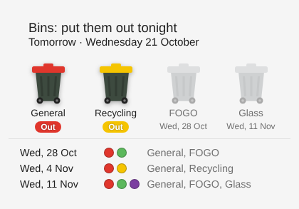

# Frankston Bins for Home Assistant

A Home Assistant integration that tells you which bins to put out for your
property in the City of Frankston (Victoria, Australia). It adds sensors, a
calendar and a dashboard card that shows coloured wheelie bins for whatever
goes out next.



## How it works

Frankston City Council's [Bin collections page](https://www.frankston.vic.gov.au/My-Property/Waste-and-recycling/My-bins/Bin-collections)
sends you to its bin day finder, [frankston.pozi.com](https://frankston.pozi.com).
That map loads the council's collection zones from
[`Kerbside_Garbage_Collection_(Widget).json`](https://connect.pozi.com/userdata/frankston-publisher/Community/Kerbside_Garbage_Collection_(Widget).json),
a GeoJSON file with one polygon per zone (Area 1 to 4, Monday to Friday). For
each bin stream a zone has an anchor date and a repeat interval:

| Bin | Lid | Zone fields | Repeats |
| --- | --- | --- | --- |
| General Waste | red | `rub_start`, `rub_weeks` | weekly |
| Mixed Recycling | yellow | `rec_start`, `rec_weeks` | fortnightly |
| Food & Garden Organics (FOGO) | light green | `grn_start`, `grn_weeks` | fortnightly, alternating with recycling |
| Glass Recycling | purple | `gls_start`, `gls_weeks` | every 4 weeks |

A bin is collected on any date that is a whole number of intervals after its
anchor date. This is the same calculation the Pozi map does. The integration:

1. Geocodes your address with the Victorian Government's Vicmap geocoder, the
   same one frankston.pozi.com uses. If Vicmap finds nothing, it falls back to
   geocode.earth.
2. Finds the zone polygon that contains your property.
3. Works out the upcoming dates locally. It re-downloads the zone file every
   12 hours in case the council changes the schedule. If the council's
   servers are down it keeps using the last zone it saw.

The results were checked against the council's printed 2026 Area 3 calendar
for every week of the year. Collections continue as normal on public
holidays, so no holiday adjustments are needed.

> The previous version of this repo used an old data.gov.au copy of the zone
> file, which returns HTTP 403 when requested from a server. This version reads
> the live file the council's own bin finder uses.

## Compatibility

- **Home Assistant 2025.2 or newer.** CI tests 2025.2, 2025.11 and 2026.2.
- **No extra Python packages.** `requirements` in the manifest is empty. The
  integration only uses the Python standard library plus `aiohttp` and
  `voluptuous`, which ship with Home Assistant. There's nothing to compile, so
  it runs on any CPU Home Assistant runs on, including 32-bit ARM (armv7/armhf)
  Raspberry Pis.
- **32-bit Raspberry Pi:** Home Assistant stopped publishing 32-bit builds
  after 2025.11, so a 32-bit Pi stays on 2025.11.x or earlier. This
  integration is tested against 2025.11.3, the last 32-bit release.
- The dashboard card is plain JavaScript that runs in your browser, with no
  build step or dependencies.

## Installation

### HACS (recommended)

1. HACS → ⋮ → **Custom repositories** → add `https://github.com/davidmcgregor/ha-frankston-bins`, category **Integration**.
2. Install **Frankston Bins**, then restart Home Assistant.

### Manual

Copy `custom_components/frankston_bins` into your Home Assistant
`config/custom_components/` folder and restart.

## Setup

**Settings → Devices & services → Add integration → Frankston Bins**, then
enter your address, e.g. `8 Robinsons Road, Frankston South`. If you leave the
address blank it uses your Home Assistant home location. If more than one
address matches, you choose from a list.

**Options:** on collection day the integration keeps showing today's
collection until a rollover time (12:00 by default), then moves on to the next
one. You can change this under the integration's **Configure** button.

## Entities

The examples use the default `frankston_bins` prefix.

| Entity | Example state | Notes |
| --- | --- | --- |
| `sensor.frankston_bins_next_collection` | `2026-10-21` | Date sensor. Attributes: `bins`, `days_until`, `summary`, `area`, `collection_day`, `bin_details`, `upcoming` |
| `sensor.frankston_bins_bins_to_put_out` | `General Waste, Mixed Recycling` | Text list of the bins for the next collection |
| `sensor.frankston_bins_summary` | `Tomorrow: General Waste and Mixed Recycling` | Ready for notifications and TTS |
| `sensor.frankston_bins_days_until_collection` | `1` | Days |
| `sensor.frankston_bins_general_waste` (also `_recycling`, `_fogo`, `_glass`) | `2026-11-11` | Next date for each bin. The entity picture is a coloured bin when it's going out next, grey otherwise |
| `binary_sensor.frankston_bins_bin_night` | `on` | On the day before collection and on collection morning |
| `binary_sensor.frankston_bins_general_waste_going_out` (also `_recycling_`, `_fogo_`, `_glass_`) | `on` / `off` | Whether this bin goes out at the next collection |
| `calendar.frankston_bins_collections` | | All-day events for every collection |
| `sensor.frankston_bins_collection_zone` | `Area 3 (Wednesday)` | Diagnostic |

## Dashboard

### Frankston Bins card

The integration ships a card, and Home Assistant loads it automatically, so
you don't need to add a resource. Add a card, search for **Frankston Bins**,
or use YAML:

```yaml
type: custom:frankston-bins-card
entity: sensor.frankston_bins_next_collection
title: Bins        # optional
upcoming: 3        # optional, how many later collections to list (0 hides them)
show_names: true   # optional
```

Bins going out are shown in their lid colour with an **Out** badge. The rest
are greyed out and show their next date. The header changes to "put them out
tonight" on bin night.

### Built-in cards only

The `*_going_out` binary sensors have coloured or greyed bin pictures, so a
glance card works as a visual indicator:

```yaml
type: vertical-stack
cards:
  - type: markdown
    content: "### 🗑️ {{ states('sensor.frankston_bins_summary') }}"
  - type: glance
    show_state: false
    entities:
      - entity: binary_sensor.frankston_bins_general_waste_going_out
        name: General
      - entity: binary_sensor.frankston_bins_recycling_going_out
        name: Recycling
      - entity: binary_sensor.frankston_bins_fogo_going_out
        name: FOGO
      - entity: binary_sensor.frankston_bins_glass_going_out
        name: Glass
```

## Automation example

```yaml
alias: Bin night reminder
triggers:
  - trigger: time
    at: "19:00:00"
conditions:
  - condition: state
    entity_id: binary_sensor.frankston_bins_bin_night
    state: "on"
actions:
  - action: notify.notify
    data:
      title: Bin night
      message: "{{ state_attr('binary_sensor.frankston_bins_bin_night', 'message') }}"
```

## Development

```bash
pip install -r requirements_test.txt
pytest
```

The tests use a snapshot of the council's zone file (`tests/fixtures/zones.json`).
They check the calculated dates against the printed 2026 calendar, and cover
the config flow, entities, calendar and card.

This integration isn't affiliated with Frankston City Council. Collection
zones are a general guide only. Check the council website if you're unsure.
